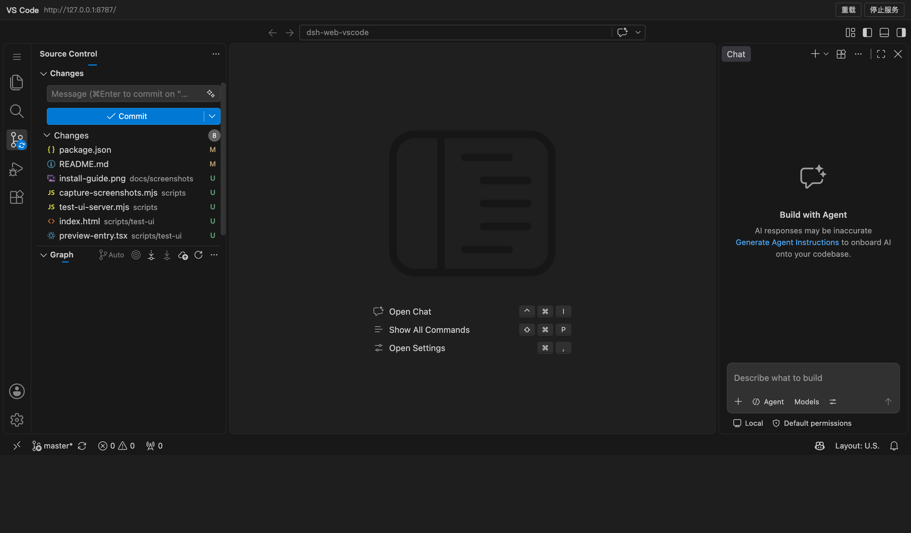
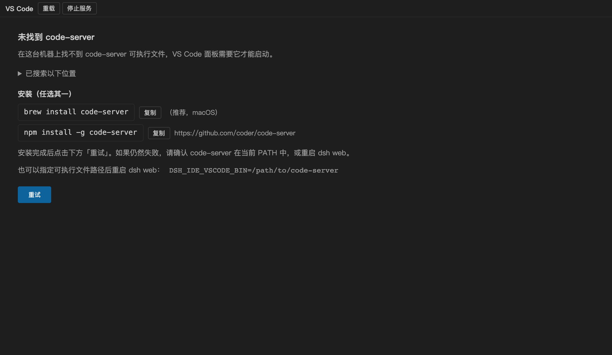

# @zhaoyang10/dsh-web-vscode

[](./LICENSE)
[](https://github.com/topics/dsh-plugin)

DSH web 客户端的 **VS Code** 插件：在会话页「对话」后面的 tab 里、以及 DSH 右侧栏，各注册一个 VS Code 标签页，点开即进入内嵌的 [code-server](https://github.com/coder/code-server) 工作区——不是模拟的编辑器，而是完整的 VS Code：扩展、终端、Git、搜索、调试全部可用。工作区自动绑定当前会话的 cwd。

| 内嵌 VS Code 工作区 | 未安装 code-server 时的引导 |
| :---: | :---: |
|  |  |

## 安装

```bash
dsh plugin --profile web add @zhaoyang10/dsh-web-vscode
```

或在 web profile 的 `package.json` 里加入依赖，并把包名追加到 `dsh.profile.bundles`，然后重启 `dsh web`。宿主机需已安装 code-server：

```bash
brew install code-server       # macOS
npm install -g code-server     # 其它平台
```

没装也没关系：打开 VS Code 标签会显示安装引导（安装命令可一键复制、列出探测过的路径、带重试按钮）。

## 功能

- **两个入口**：会话页顶部「VS Code」视图 tab，以及右侧栏的 VS Code tab（打开时自动全屏）。
- **真正的 VS Code**：由本插件为每个会话拉起独立的 code-server 进程（`127.0.0.1` + `--auth none`，仅本机可访问），iframe 内就是完整 workbench，扩展、终端、Git、搜索、调试与原生 VS Code 一致。
- **切 tab 不重载**：iframe 不放在 React 树里，而是挂在 `<body>` 下的常驻覆盖层中。切到「对话」或其它标签只是隐藏（`display:none`），已打开的编辑器、终端与滚动位置全部保留，切回来即用。
- **进程随会话存活**：「停止服务」或 DSH 退出才结束 code-server；关闭标签页不杀进程，重开即时恢复。
- **AI 提交信息**：随包附带的 VS Code 扩展在源代码管理面板加一个按钮，复用当前 DSH 会话配置的模型，根据暂存/工作区 diff、分支名与近期提交风格生成提交信息并填入提交框（再次点击可取消生成）。
- **与 dsh-web-ide 共享状态**：code-server 的 `user-data` / `extensions` 位于 `~/.dsh-ide/code-server/`，与 [dsh-web-ide](https://github.com/fengzhaoy/dsh-web-ide) 互通，已装扩展不必重装。

## 配置

| 项 | 说明 |
| :--- | :--- |
| `DSH_IDE_VSCODE_BIN` | 指定 code-server 可执行文件路径（默认按 PATH 与常见安装目录探测） |
| 端口 | 从 8787 起自动挑选空闲端口，每个会话一个进程 |
| 状态目录 | `~/.dsh-ide/code-server/`（`user-data`、`extensions`） |

## 开发

```bash
pnpm install
pnpm bundle        # tsdown 构建到 lib/
pnpm test          # 静态检查 + 生命周期回归 + code-server 真实启停往返
pnpm typecheck
```

## 许可

MIT